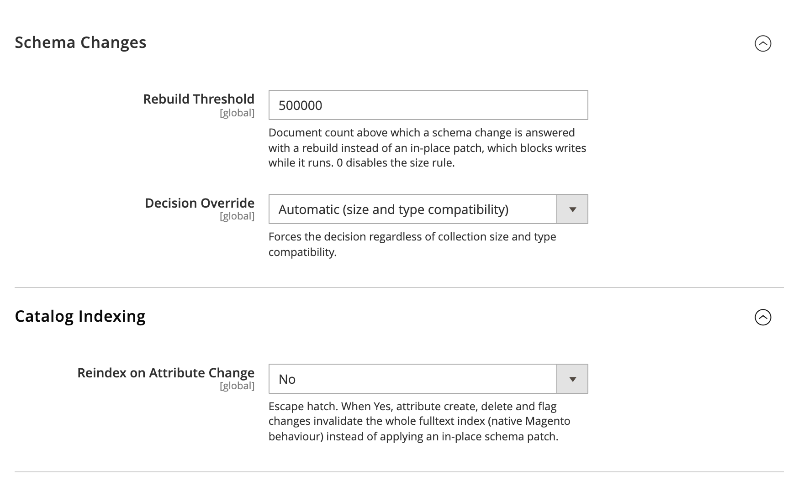

# DmLab_TypesenseIndexer

[](https://github.com/dmlab-work/module-typesense-indexer/actions/workflows/ci.yml) [](https://codecov.io/gh/dmlab-work/module-typesense-indexer) [](https://packagist.org/packages/dmlab/module-typesense-indexer) [](https://packagist.org/packages/dmlab/module-typesense-indexer) [](https://packagist.org/packages/dmlab/module-typesense-indexer) [](LICENSE) 

Indexes your Magento catalog into Typesense. Turn an attribute into a filter (or back) and it shows up in
layered navigation after an in-place schema patch (≈0.3 s on 50k products) — no full catalog reindex, where native
Magento invalidates the whole search index. A full reindex builds a fresh index and switches to it at the end, so
search never goes empty or stale mid-reindex.



## Install

Most stores install the search module, which pulls this one and core:

```bash
composer require dmlab/module-typesense-search
bin/magento module:enable DmLab_TypesenseCore DmLab_TypesenseIndexer DmLab_TypesenseSearch
bin/magento setup:upgrade
```

Standalone:

```bash
composer require dmlab/module-typesense-indexer
bin/magento module:enable DmLab_TypesenseIndexer
bin/magento setup:upgrade
```

## Requirements

Magento 2.4.7+ · PHP 8.2–8.5 · Typesense ≥ 30.0 (synonym sets) · `dmlab/module-typesense-core ^0.2.0`.

Pairs with [typesense-search](https://github.com/dmlab-work/module-typesense-search) (search engine, category pages, layered navigation) and [typesense-instant-search](https://github.com/dmlab-work/module-typesense-instant-search) (search-as-you-type dropdown).

## Configuration

This module owns the Typesense configuration; `dmlab/module-typesense-core` reads it through
`TypesenseCore\Api\ConnectionSettingsInterface`.

- **Connection** — *Stores → Configuration → Catalog → Catalog Search*, shown when the engine is
  `typesense` (`catalog/search/typesense_*`: host, port, index prefix, API key, protocol, additional
  nodes, timeouts, retry, health-cache TTL). The API key is encrypted and `sensitive`.
- **Schema Changes** — *DMLab → Typesense → Schema Changes*: `rebuild_threshold` (default 500000;
  above it a schema change triggers a rebuild instead of an in-place patch; 0 disables the size rule) and
  `decision_override` (`auto` by size and type compatibility — default, always patch in place, always rebuild).
- **Catalog Indexing** — *Reindex on Attribute Change* (default No), see [Architecture](#architecture).
- The `dmlab` tab, `dmlab_typesense` section and `DmLab_TypesenseIndexer::config` ACL resource are
  defined here; other suite modules only add their own groups.

## Reindex model

A full reindex builds a fresh collection per store view, imports documents in batches, and switches
the alias onto it as the final step. Consumers query the alias `typesense_<indexerId>_<storeId>`
(e.g. `typesense_catalogsearch_fulltext_1`); the versioned collection behind it is swapped atomically.

- **Partial reindex**: changed products are upserted first, then only the ids that were not rebuilt
  are deleted (batched `filter_by=id:[…]`), so products never vanish mid-update.
- **Orphan prune**: after each swap, older versions of the same alias (e.g. left by a killed
  rebuild) are dropped; newer ones are kept as another process's pending build.
- **Store delete** (directly or with its website/store group) drops the store's aliases, collections
  and synonym set.

## Public collection

Each store also gets `<alias>_public` for direct browser queries with a search-only key. The main
collection holds every customer group's price, so it must never be exposed. The public one holds
only `name`, `sku`, `short_description`, option labels (`<code>_value`) of storefront-exposed
attributes (searchable, filterable, visible on front, used in listing or sorting), `visibility`,
`status`, `is_in_stock`, `price` (NOT LOGGED IN group), `thumbnail` (falling back to `small_image`,
then `image`) and the stored `url_key`, `tax_class_id`. No facets.

Making a non-exposed option attribute exposed invalidates `catalogsearch_fulltext` (its labels need a
reindex). The public collection follows the main one's lifecycle (rebuild + swap, partial, delete).
Resolve its name with `IndexNameResolverInterface::getPublicAliasName()`.

## Synonyms

Native synonym groups (*Marketing → SEO & Search → Search Synonyms*) are synced to the Typesense
synonym set `<alias>_synonyms` per store: after every full rebuild and on each group save/delete.

## Hosting

```bash
docker run -d --name typesense -p 8108:8108 -v typesense-data:/data typesense/typesense:30.2 --data-dir /data --api-key=<admin-key>
```

One binary. Plan roughly 0.5–1 GB RAM for a typical catalog — only fields used for search, filter or
sort are held in memory. Typesense Cloud works: its host, port 443, `https`. Not available on Adobe
Commerce Cloud or Hypernode.

## Tests

Integration tests run against a real Typesense and skip unless `TYPESENSE_TEST_URL` and
`TYPESENSE_TEST_API_KEY` are set: `vendor/bin/phpunit -c Test/Integration/phpunit.xml`.

## Architecture

L1 of the DMLab Typesense suite. It implements Magento's indexer contracts (`IndexStructureInterface`,
`SaveHandler\IndexerInterface`), so the standard `catalogsearch_fulltext` indexer writes to Typesense
instead of Elasticsearch/OpenSearch. It is the single writer of catalog collections —
`typesense-search` and any other read model consume the same documents.

### FAT documents, THIN schema

A Typesense document stores its full JSON on disk, including undeclared keys (only declared fields
cost RAM), and a schema `PATCH` rebuilds the index from the stored documents without a reimport.
So every attribute value goes into the document regardless of its flags (FAT), but only the fields
the flags require are declared (THIN). Changing a search flag, creating or deleting an attribute is
an in-place schema PATCH, not a reindex. Only when a PATCH is unsafe or over `rebuild_threshold` does
the module fall back to native invalidation.

Escape hatch: *DMLab → Typesense → Catalog Indexing → Reindex on Attribute Change = Yes*
(`dmlab_typesense/indexer/use_native_invalidation`, default No) disables the PATCH path for attribute
create, delete and flag changes and restores native invalidation.

What a document carries:

- **Composite products** (configurable, bundle, grouped) carry the union of their own and their
  enabled children's option values, so a configurable matches `color`/`size` filters. Out-of-stock
  children are skipped unless *Display Out of Stock Products* is on.
- **Types**: booleans are `int32` 0/1; select/multiselect are always `int32[]` option ids; every
  value, declared or not, is cast to its policy type.
- **Labels**: option attributes also store `<code>_value` (`string[]`, store labels), the field that
  searchable options are queried by, and `sort_<code>` (first label) when `used_for_sort_by = 1`.
  Searchable text has HTML stripped.
- **Prices and positions** use regex fields `price_[0-9]+_.*` (`price_<group>_<website>`, from
  `min_price`) and `position_category_.*`, so a new customer group, website or category needs no
  schema change.
- **Stock**: `is_in_stock` (legacy stock status) and `is_out_of_stock` (the website's MSI salability
  when MSI is enabled, else legacy). The public collection's `is_in_stock` is derived from the latter.

### Extension points

Everything is contributed through di-merged composites — nobody writes a document or PATCHes a
collection directly, and the schema is computed (`base + Σ providers`), so additions cannot collide.
Register a provider by merging into the matching composite's `providers` array in `di.xml`.

#### Schema fields

`Model/Schema/FieldProviderInterface` — `getFields(int $storeId): FieldSpec[]`; extra keys go through
`FieldSpec::extra` (e.g. vector fields).

#### Document data

`Model/Document/DocumentDataProviderInterface` — `addData(array $documents, int $storeId)`; providers
chain in array order (`attribute` → `children` → `labels` → …). Register after `labels` to see
composite-merged option ids and their labels. Data may be written with no schema field declaring it.

#### Searchable fields

`Api/SearchableFieldsProviderInterface` — `get(int $storeId): array` returns field ⇒ query weight, the
single source `typesense-search` and `typesense-instant-search` map onto `query_by` / their browser
config, so the query side never drifts from the indexed side.

## License

OSL-3.0 © DMLab.
